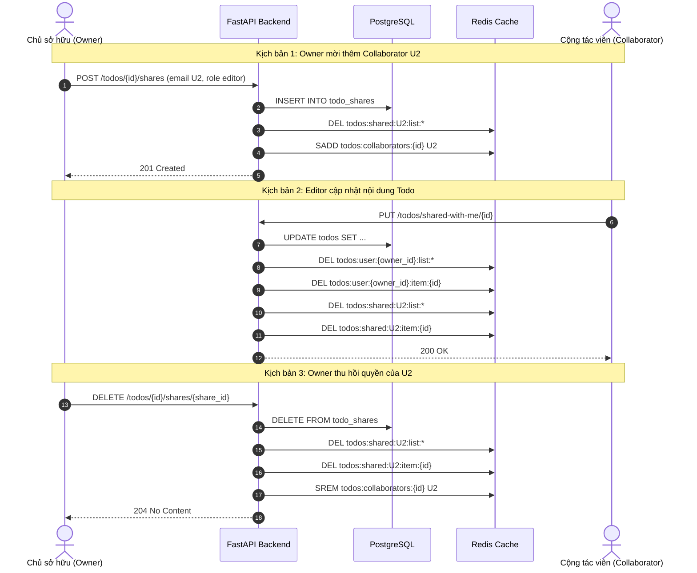

# Technical Specification: Tính năng Chia sẻ & Cộng tác Todo (Todo Sharing)

> **Phiên bản tài liệu**: 1.0.0  
> **Trạng thái**: Đã phê duyệt triển khai  
> **Tác giả**: Senior Full-Stack Engineering Assessment  
> **Phiên bản mục tiêu**: v1.3.0  
> **Template gốc**: [`templates/SPEC_TEMPLATE.md`](../templates/SPEC_TEMPLATE.md)

---

## 1. Overview & Objective

### Feature Summary (Tổng quan tính năng)
Tính năng **Chia sẻ & Cộng tác Todo (Todo Sharing)** cho phép người dùng đã đăng ký trong hệ thống chia sẻ các công việc (todo) cá nhân của mình cho những người dùng khác với các mức phân quyền chi tiết (granular permissions):
- **`viewer` (Chỉ xem)**: Cộng tác viên có thể xem tiêu đề, mô tả, trạng thái hoàn thành và các mốc thời gian của todo được chia sẻ.
- **`editor` (Chỉnh sửa)**: Cộng tác viên có thể xem và cập nhật tiêu đề, mô tả và chuyển đổi trạng thái hoàn thành của todo.
- **`owner` (Chủ sở hữu / Người tạo)**: Người tạo công việc ban đầu giữ toàn quyền quản trị, bao gồm chỉnh sửa, xóa công việc, mời thêm người và thu hồi quyền của bất kỳ cộng tác viên nào tại bất kỳ thời điểm nào.

### Problem Statement (Vấn đề giải quyết)
Hiện tại, ứng dụng Todo hoạt động theo mô hình đơn người dùng (single-tenant per user) tuyệt đối. Người dùng không thể phối hợp công việc, ủy quyền nhiệm vụ hoặc hiển thị tiến độ cho đồng nghiệp/người thân mà không phải chia sẻ thông tin tài khoản đăng nhập (vi phạm nghiêm trọng nguyên tắc an toàn thông tin và quyền riêng tư). Việc triển khai cơ chế chia sẻ có phân quyền tối thiểu (least privilege) sẽ biến ứng dụng thành một công cụ quản lý công việc cộng tác linh hoạt mà vẫn đảm bảo tính cô lập và bảo mật dữ liệu tuyệt đối.

### Target Audience & Roles (Đối tượng & Vai trò)
| Vai trò | Mô tả | Phạm vi quyền hạn |
|---|---|---|
| **Owner (Chủ sở hữu)** | Người dùng trực tiếp tạo ra todo đó. | Toàn quyền CRUD trên todo; quản lý chia sẻ (mời, cập nhật role, thu hồi); xóa todo. |
| **Editor (Cộng tác viên sửa)** | Người dùng được mời với quyền `editor`. | Xem chi tiết; cập nhật tiêu đề, mô tả, trạng thái hoàn thành. Không thể xóa todo hoặc chia sẻ tiếp. |
| **Viewer (Cộng tác viên xem)** | Người dùng được mời với quyền `viewer`. | Quyền chỉ đọc (read-only) đối với nội dung todo. Không thể chỉnh sửa, không thể xóa hoặc chia sẻ tiếp. |
| **Unrelated User (Người dùng khác)** | Bất kỳ người dùng nào không phải owner và chưa được share. | Không có bất kỳ quyền truy cập nào. Hệ thống ẩn thông tin bằng cách trả về `404 Not Found` (tránh rò rỉ ID). |

---

## 2. User Stories & Acceptance Criteria

### User Story 1: Chia sẻ Todo cho người dùng khác (Owner)
- **As an** Owner của một Todo
- **I want to** mời người dùng khác thông qua địa chỉ email đã đăng ký và gán vai trò `viewer` hoặc `editor`
- **So that** chúng tôi có thể cùng theo dõi hoặc phối hợp xử lý công việc.
- **Acceptance Criteria**:
  - [ ] Khi Owner gửi email hợp lệ của một user đã tồn tại `U2` cùng vai trò `editor` tới API, một bản ghi chia sẻ mới được tạo và API trả về HTTP `201 Created`.
  - [ ] Nếu email người nhận không tồn tại trong hệ thống, API trả về HTTP `404 Not Found` với thông báo `"User with specified email not found"`.
  - [ ] Nếu Owner tự chia sẻ công việc cho chính email của mình, API từ chối với HTTP `400 Bad Request` và mã lỗi `"CANNOT_SHARE_WITH_SELF"`.
  - [ ] Nếu công việc này đã được chia sẻ cho `U2` từ trước, API trả về HTTP `409 Conflict` và mã lỗi `"USER_ALREADY_HAS_ACCESS"`.
  - [ ] Cache danh sách todo được chia sẻ của người được mời (`U2`) lập tức bị xóa (invalidated).

### User Story 2: Xem danh sách cộng tác viên của một Todo (Owner)
- **As an** Owner của một Todo
- **I want to** xem danh sách tất cả các cộng tác viên đang có quyền truy cập cùng vai trò của họ
- **So that** tôi có thể kiểm soát và đánh giá mức độ an toàn dữ liệu của công việc mình quản lý.
- **Acceptance Criteria**:
  - [ ] Owner nhận được mảng danh sách chứa `share_id`, `invitee_id`, `invitee_email`, `role`, và `created_at`.
  - [ ] Nếu một user không phải Owner gọi API này, hệ thống trả về HTTP `403 Forbidden` (hoặc `404 Not Found` nếu không liên quan).

### User Story 3: Cập nhật vai trò quyền hạn của Cộng tác viên (Owner)
- **As an** Owner của một Todo
- **I want to** thay đổi vai trò của cộng tác viên giữa `viewer` và `editor`
- **So that** tôi có thể điều chỉnh quyền hạn linh hoạt theo từng giai đoạn công việc.
- **Acceptance Criteria**:
  - [ ] Owner gửi `PUT /api/v1/todos/{todo_id}/shares/{share_id}` với body `{ "role": "editor" }` hoặc `{ "role": "viewer" }`.
  - [ ] Bản ghi chia sẻ được cập nhật trong cơ sở dữ liệu và trả về HTTP `200 OK`.
  - [ ] Toàn bộ cache liên quan của cả Owner và cộng tác viên tương ứng trên Redis đều bị xóa ngay lập tức.

### User Story 4: Thu hồi quyền truy cập của Cộng tác viên (Owner)
- **As an** Owner của một Todo
- **I want to** thu hồi quyền truy cập của bất kỳ cộng tác viên nào bất cứ lúc nào
- **So that** họ ngay lập tức không còn quyền xem hoặc chỉnh sửa todo của tôi nữa.
- **Acceptance Criteria**:
  - [ ] Owner gửi `DELETE /api/v1/todos/{todo_id}/shares/{share_id}`.
  - [ ] Bản ghi chia sẻ bị xóa khỏi database, API trả về HTTP `204 No Content`.
  - [ ] Cache của cộng tác viên lập tức bị vô hiệu hoá. Mọi yêu cầu đọc/ghi tiếp theo từ cộng tác viên này sẽ trả về HTTP `404 Not Found` hoặc `403 Forbidden`.

### User Story 5: Xem danh sách công việc được người khác chia sẻ (Collaborator)
- **As a** Cộng tác viên (Viewer hoặc Editor)
- **I want to** xem danh sách các công việc mà người khác đã chia sẻ cho tôi ở một giao diện riêng biệt
- **So that** tôi có thể quản lý và nắm bắt các công việc chung mà không bị lẫn lộn vào danh sách việc riêng của mình.
- **Acceptance Criteria**:
  - [ ] Cộng tác viên gọi `GET /api/v1/todos/shared-with-me?page=1&limit=10`.
  - [ ] Kết quả trả về danh sách phân trang kèm theo thông tin email của Owner, vai trò được gán (`my_role`), và nội dung todo.
  - [ ] Tuyệt đối không hiển thị các todo của người khác mà bản thân không được chia sẻ.
  - [ ] Những công việc đã bị Owner thu hồi quyền không được xuất hiện trong danh sách.

### User Story 6: Chỉnh sửa Todo được chia sẻ (Editor)
- **As an** Editor Cộng tác viên
- **I want to** cập nhật tiêu đề, mô tả và đánh dấu hoàn thành cho todo được chia sẻ
- **So that** tôi có thể báo cáo tiến độ và đóng góp nội dung công việc chung.
- **Acceptance Criteria**:
  - [ ] Editor gửi `PUT /api/v1/todos/shared-with-me/{todo_id}` với thông tin mới.
  - [ ] Cập nhật thành công vào cơ sở dữ liệu và trả về HTTP `200 OK`.
  - [ ] Cả cache của Owner và cache của Editor đều được làm mới.
  - [ ] Nếu một user chỉ có quyền `viewer` gửi request chỉnh sửa, API trả về HTTP `403 Forbidden` với lỗi `"READ_ONLY_ACCESS"`.
  - [ ] Editor không có quyền xóa Todo (yêu cầu `DELETE` trả về `403 Forbidden`).

---

## 3. Scope (Phạm vi tính năng)

### In-Scope (Thuộc phạm vi phiên bản v1.3.0)
1. Chia sẻ từng công việc cụ thể (Todo-level sharing).
2. Hai mức phân quyền rõ ràng: `viewer` (chỉ đọc) và `editor` (đọc & sửa).
3. Mời cộng tác viên qua địa chỉ email của người dùng đã có tài khoản trên hệ thống.
4. Xem danh sách cộng tác viên, đổi role, và thu hồi quyền bởi Owner.
5. Endpoint riêng cho cộng tác viên xem danh sách các việc được chia sẻ (`/todos/shared-with-me`).
6. Cho phép Editor chỉnh sửa nội dung và toggle trạng thái hoàn thành.
7. Ràng buộc cơ sở dữ liệu chặt chẽ: Unique constraint chống trùng lặp, Check constraint chống tự chia sẻ cho chính mình, Foreign key Cascade khi xoá Todo hoặc User.
8. Cơ chế xóa cache Redis đồng bộ ngay khi phân quyền hoặc nội dung todo thay đổi.

### Out-of-Scope (Chưa làm trong phiên bản này để tránh scope creep)
1. **Chia sẻ toàn bộ danh sách / thư mục**: Tính năng chia sẻ cả project hoặc toàn bộ danh sách todo của một user (để dành phiên bản v2.0).
2. **Chia sẻ bằng đường link công khai (Public Link Sharing)**: Tạo link xem không cần đăng nhập tài khoản.
3. **Phân quyền lồng nhau (Re-sharing / Delegated sharing)**: Cho phép cộng tác viên mời tiếp người thứ 3 (trong v1.3.0 chỉ duy nhất Owner mới có quyền mời).
4. **Cộng tác thời gian thực kiểu Google Docs (Real-time OT / CRDT)**: Xử lý gõ phím đồng thời theo từng ký tự. Phiên bản này áp dụng nguyên tắc Last-Write-Wins có kiểm tra trạng thái quyền nguyên tử.
5. **Hệ thống thông báo đẩy / Email tự động**: Gửi email thông báo khi được mời (sẽ tách riêng thành microservice notification trong tương lai).

---

## 4. Database Design (Thiết kế Cơ sở dữ liệu)

### Bảng mới: `todo_shares`

```sql
CREATE TYPE share_role_enum AS ENUM ('viewer', 'editor');

CREATE TABLE todo_shares (
    id UUID PRIMARY KEY DEFAULT gen_random_uuid(),
    todo_id UUID NOT NULL,
    owner_id UUID NOT NULL,
    invitee_id UUID NOT NULL,
    role share_role_enum NOT NULL DEFAULT 'viewer',
    created_at TIMESTAMPTZ NOT NULL DEFAULT CURRENT_TIMESTAMP,
    updated_at TIMESTAMPTZ NOT NULL DEFAULT CURRENT_TIMESTAMP,

    -- Khóa ngoại liên kết
    CONSTRAINT fk_todo_shares_todo 
        FOREIGN KEY (todo_id) REFERENCES todos(id) ON DELETE CASCADE,
    CONSTRAINT fk_todo_shares_owner 
        FOREIGN KEY (owner_id) REFERENCES users(id) ON DELETE CASCADE,
    CONSTRAINT fk_todo_shares_invitee 
        FOREIGN KEY (invitee_id) REFERENCES users(id) ON DELETE CASCADE,

    -- Ràng buộc tính toàn vẹn dữ liệu
    CONSTRAINT uq_todo_shares_todo_invitee 
        UNIQUE (todo_id, invitee_id),
    CONSTRAINT chk_todo_shares_prevent_self_share 
        CHECK (owner_id <> invitee_id)
);
```

### Mô tả chi tiết các cột

| Tên cột | Kiểu dữ liệu | Nullable | Giá trị mặc định | Diễn giải |
|---|---|---|---|---|
| `id` | `UUID` | No | `gen_random_uuid()` | Khóa chính của bản ghi chia sẻ. |
| `todo_id` | `UUID` | No | - | Khóa ngoại tham chiếu tới `todos.id`. Tự động xóa theo (Cascade) khi todo bị xóa. |
| `owner_id` | `UUID` | No | - | Khóa ngoại tham chiếu tới `users.id` (Chủ sở hữu). |
| `invitee_id` | `UUID` | No | - | Khóa ngoại tham chiếu tới `users.id` (Cộng tác viên được mời). |
| `role` | `share_role_enum` | No | `'viewer'` | Vai trò cấp quyền: `'viewer'` hoặc `'editor'`. |
| `created_at` | `TIMESTAMPTZ` | No | `CURRENT_TIMESTAMP` | Thời điểm tạo lời mời (UTC). |
| `updated_at` | `TIMESTAMPTZ` | No | `CURRENT_TIMESTAMP` | Thời điểm cập nhật vai trò gần nhất (UTC). |

### Ràng buộc & Tối ưu hóa Chỉ mục (Constraints & Indexes)

1. **Ràng buộc duy nhất (Unique Constraint)**: `UNIQUE (todo_id, invitee_id)`
   - Đảm bảo một cộng tác viên không bao giờ bị mời trùng lặp 2 lần vào cùng 1 công việc, ngăn chặn hoàn toàn hiện tượng race condition khi gửi nhiều request mời đồng thời.
2. **Ràng buộc kiểm tra (Check Constraint)**: `CHECK (owner_id <> invitee_id)`
   - Ngăn chặn ngay từ tầng database việc chủ sở hữu tự chia sẻ công việc cho chính bản thân mình.
3. **Cơ chế Cascade Delete**:
   - Khi `todo` bị xóa bởi Owner: Mọi bản ghi chia sẻ tương ứng trong bảng `todo_shares` sẽ tự động bị xóa theo.
   - Khi tài khoản `user` bị xóa: Các bản ghi mời và được mời liên quan sẽ được dọn dẹp sạch sẽ.
4. **Các Index cần đánh**:
   - `CREATE INDEX ix_todo_shares_invitee_id ON todo_shares (invitee_id);`: Tối ưu hóa truy vấn khi cộng tác viên lấy danh sách việc được chia sẻ (`GET /todos/shared-with-me`).
   - `CREATE INDEX ix_todo_shares_todo_id ON todo_shares (todo_id);`: Tối ưu hóa khi Owner lấy danh sách cộng tác viên hoặc khi cần tìm tất cả user để xóa cache.
   - `CREATE INDEX ix_todo_shares_lookup ON todo_shares (todo_id, invitee_id);`: Tối ưu hóa việc kiểm tra quyền truy cập của cộng tác viên trên một todo trong thời gian $O(1)$.

---

## 5. API Contracts & Endpoints (Đặc tả API)

### Bảng tổng hợp Endpoints

| Phương thức | Endpoint | Mô tả chức năng | Yêu cầu Auth | Phân quyền cho phép |
|---|---|---|:---:|---|
| `POST` | `/api/v1/todos/{todo_id}/shares` | Mời cộng tác viên theo email | Có (Bearer) | Owner |
| `GET` | `/api/v1/todos/{todo_id}/shares` | Lấy danh sách cộng tác viên của Todo | Có (Bearer) | Owner |
| `PUT` | `/api/v1/todos/{todo_id}/shares/{share_id}` | Cập nhật vai trò cộng tác viên | Có (Bearer) | Owner |
| `DELETE` | `/api/v1/todos/{todo_id}/shares/{share_id}` | Thu hồi quyền truy cập | Có (Bearer) | Owner |
| `GET` | `/api/v1/todos/shared-with-me` | Lấy danh sách todo được chia sẻ cho mình | Có (Bearer) | Người dùng đăng nhập |
| `GET` | `/api/v1/todos/shared-with-me/{todo_id}` | Xem chi tiết 1 todo được chia sẻ | Có (Bearer) | Invitee (`viewer` / `editor`) |
| `PUT` | `/api/v1/todos/shared-with-me/{todo_id}` | Sửa nội dung của todo được chia sẻ | Có (Bearer) | Invitee (`editor` only) |

---

### Chi tiết Request / Response Schemas

#### 1. Mời cộng tác viên (`POST /api/v1/todos/{todo_id}/shares`)
- **Headers**: `Authorization: Bearer <access_token>`
- **Request Body**:
  ```json
  {
    "email": "colleague@example.com",
    "role": "editor"
  }
  ```
- **Response thành công (201 Created)**:
  ```json
  {
    "id": "7b0a8878-b39b-449e-b2d9-3543d83b0f51",
    "todo_id": "90e386fe-2aa8-45d6-b09e-716279f53857",
    "owner_id": "c1a2f641-4c6e-4e3a-96cf-7a3c799a7791",
    "invitee_id": "f5b822d6-4e5c-449e-a89e-4e9b986e41b2",
    "invitee_email": "colleague@example.com",
    "role": "editor",
    "created_at": "2026-09-16T10:00:00Z",
    "updated_at": "2026-09-16T10:00:00Z"
  }
  ```
- **Mã lỗi xử lý**:
  - `400 Bad Request`: `{"detail": "Cannot share a todo with yourself"}` (Tự share cho mình).
  - `401 Unauthorized`: Token không hợp lệ hoặc thiếu.
  - `403 Forbidden`: Người dùng hiện tại không phải là chủ sở hữu của todo này.
  - `404 Not Found`: Không tìm thấy todo hoặc email người được mời không tồn tại.
  - `409 Conflict`: `{"detail": "Todo is already shared with this user"}` (Đã mời trước đó).

#### 2. Xem danh sách cộng tác viên (`GET /api/v1/todos/{todo_id}/shares`)
- **Response thành công (200 OK)**:
  ```json
  [
    {
      "id": "7b0a8878-b39b-449e-b2d9-3543d83b0f51",
      "todo_id": "90e386fe-2aa8-45d6-b09e-716279f53857",
      "invitee_id": "f5b822d6-4e5c-449e-a89e-4e9b986e41b2",
      "invitee_email": "colleague@example.com",
      "role": "editor",
      "created_at": "2026-09-16T10:00:00Z"
    }
  ]
  ```

#### 3. Thay đổi vai trò (`PUT /api/v1/todos/{todo_id}/shares/{share_id}`)
- **Request Body**:
  ```json
  {
    "role": "viewer"
  }
  ```
- **Response thành công (200 OK)**: Trả về đối tượng share với `role` mới và `updated_at` đã cập nhật.

#### 4. Thu hồi quyền (`DELETE /api/v1/todos/{todo_id}/shares/{share_id}`)
- **Response thành công (204 No Content)**: Thân phản hồi rỗng.

#### 5. Danh sách todo được chia sẻ cho tôi (`GET /api/v1/todos/shared-with-me`)
- **Query Parameters**:
  - `page`: int (mặc định: `1`, tối thiểu: `1`)
  - `limit`: int (mặc định: `10`, tối thiểu: `1`, tối đa: `100`)
  - `completed`: optional bool (`true` / `false`)
- **Response thành công (200 OK)**:
  ```json
  {
    "items": [
      {
        "id": "90e386fe-2aa8-45d6-b09e-716279f53857",
        "title": "Báo cáo tài chính quý",
        "description": "Chuẩn bị slide tổng kết số liệu doanh thu",
        "completed": false,
        "owner_id": "c1a2f641-4c6e-4e3a-96cf-7a3c799a7791",
        "owner_email": "boss@example.com",
        "my_role": "editor",
        "created_at": "2026-09-15T08:30:00Z",
        "updated_at": "2026-09-16T09:00:00Z"
      }
    ],
    "total": 1,
    "page": 1,
    "limit": 10
  }
  ```

#### 6. Chỉnh sửa Todo được chia sẻ (`PUT /api/v1/todos/shared-with-me/{todo_id}`)
- **Request Body**:
  ```json
  {
    "title": "Báo cáo tài chính quý [Đã rà soát]",
    "description": "Đã cập nhật số liệu EBITDA chính xác",
    "completed": true
  }
  ```
- **Response thành công (200 OK)**: Đối tượng Todo sau khi cập nhật.
- **Mã lỗi xử lý**:
  - `403 Forbidden`: Người dùng chỉ có vai trò `viewer` (`"Write permission required"`).
  - `404 Not Found`: Todo không tồn tại hoặc người dùng không có bản ghi chia sẻ hợp lệ.

---

## 6. Business Logic & Security Considerations (Nghiệp vụ & Bảo mật)

### Ma trận Phân quyền & Thao tác (Permission Matrix)

| Thao tác | Owner | Editor | Viewer | Chưa đăng nhập / Người lạ |
|---|:---:|:---:|:---:|:---:|
| **Xem Todo của chính mình** (`GET /todos`) |  Có | — | — |  Không (401/404) |
| **Mời người khác** (`POST /todos/{id}/shares`) |  Có |  Không (403) |  Không (403) |  Không (401/404) |
| **Xem danh sách mời** (`GET /todos/{id}/shares`) |  Có |  Không (403) |  Không (403) |  Không (401/404) |
| **Đổi vai trò** (`PUT /todos/{id}/shares/{id}`) |  Có |  Không (403) |  Không (403) |  Không (401/404) |
| **Thu hồi quyền** (`DELETE /todos/{id}/shares/{id}`) |  Có |  Không (403) |  Không (403) |  Không (401/404) |
| **Xem Todo được chia sẻ** (`GET /shared-with-me/{id}`) | — |  Có |  Có |  Không (404) |
| **Sửa Todo được chia sẻ** (`PUT /shared-with-me/{id}`) |  Có |  Có |  Không (403) |  Không (404) |
| **Xóa Todo** (`DELETE /todos/{id}`) |  Có |  Không (403) |  Không (403) |  Không (404) |

### Phòng chống IDOR & Rò rỉ thông tin
1. **Che giấu sự tồn tại của tài nguyên (Opaque Error Masking)**:
   - Nếu người dùng cố tình truy cập vào endpoint quản lý chia sẻ của một todo không thuộc sở hữu của mình, hệ thống trả về `404 Not Found` thay vì `403 Forbidden` để ngăn chặn kẻ xấu quét dò dải ID (UUID enumeration).
2. **Xác thực quyền nguyên tử ở tầng Service**:
   - Mọi thao tác quản lý share bắt buộc phải kiểm tra điều kiện `todo.user_id == current_user.id`.
   - Mọi thao tác đọc/ghi của cộng tác viên bắt buộc phải join với bảng `todo_shares` với điều kiện `todo_shares.todo_id == :todo_id AND todo_shares.invitee_id == :current_user_id`.

### Xử lý các trường hợp biên & Xung đột đồng thời (Edge Cases & Race Conditions)
1. **Chặn tự chia sẻ (Self-Sharing)**:
   - Kiểm tra ngay tại tầng Pydantic/Service (`owner_id == invitee_id`) và chặn ở tầng DB bằng ràng buộc `CHECK (owner_id <> invitee_id)`. Trả về `400 Bad Request`.
2. **Xung đột mời trùng lặp (Duplicate Invites)**:
   - Nếu hai request mời cùng 1 email gửi tới đồng thời, ràng buộc `UNIQUE (todo_id, invitee_id)` sẽ khiến một request vi phạm `IntegrityError`, được bắt lại và trả về `409 Conflict`.
3. **Owner thu hồi quyền trong lúc Collaborator đang bấm lưu**:
   - Khi Editor gửi request chỉnh sửa, service thực hiện kiểm tra quyền có khóa bản ghi:
     ```sql
     SELECT role FROM todo_shares WHERE todo_id = :todo_id AND invitee_id = :user_id FOR UPDATE;
     ```
     Nếu bản ghi share đã bị xóa bởi giao dịch thu hồi của Owner, giao dịch cập nhật sẽ hủy bỏ ngay và trả về HTTP `403 Forbidden` ("Quyền truy cập đã bị thu hồi bởi chủ sở hữu").
4. **Owner xóa Todo đang được chia sẻ**:
   - Ràng buộc `ON DELETE CASCADE` ở database sẽ tự động xóa sạch các dòng trong `todo_shares`.
   - Hệ thống phát tín hiệu xóa cache Redis tương ứng của tất cả cộng tác viên liên quan.
5. **Cộng tác viên cố tình chia sẻ lại (Re-sharing)**:
   - Chỉ có Owner mới có quyền truy cập vào các API chia sẻ. Các role khác gọi vào đều bị chặn ngay lập tức.

---

## 7. Caching & Invalidation Strategy (Chiến lược Cache Redis)

### Cấu trúc Namespace của Redis Cache Keys

| Định dạng Key | Kiểu dữ liệu | TTL | Mục đích sử dụng |
|---|---|---|---|
| `todos:user:{user_id}:list:*` | String (JSON) | 300s (5 phút) | Cache danh sách todo cá nhân của người dùng. |
| `todos:user:{user_id}:item:{todo_id}` | String (JSON) | 300s (5 phút) | Cache chi tiết 1 todo thuộc sở hữu cá nhân. |
| `todos:shared:{invitee_id}:list:*` | String (JSON) | 300s (5 phút) | Cache danh sách todo được người khác chia sẻ cho user này. |
| `todos:shared:{invitee_id}:item:{todo_id}` | String (JSON) | 300s (5 phút) | Cache chi tiết 1 todo được chia sẻ cho user này. |
| `todos:collaborators:{todo_id}` | Set | 600s (10 phút) | Tập hợp các `invitee_id` đang có quyền vào `todo_id` để xóa cache hàng loạt. |

### Quy trình Vô hiệu hoá Cache (Cache Invalidation Protocols)



#### Nguyên tắc xóa Cache cụ thể:
1. **Khi Owner chia sẻ Todo cho Người dùng B**:
   - Xóa ngay cache danh sách chia sẻ của B: `DEL todos:shared:{UserB_id}:list:*`.
   - Lưu B vào danh sách cộng tác viên: `SADD todos:collaborators:{todo_id} {UserB_id}`.
2. **Khi Owner thu hồi quyền của Người dùng B**:
   - Xóa cache danh sách của B: `DEL todos:shared:{UserB_id}:list:*`.
   - Xóa cache chi tiết todo của B: `DEL todos:shared:{UserB_id}:item:{todo_id}`.
   - Loại B khỏi danh sách cộng tác viên: `SREM todos:collaborators:{todo_id} {UserB_id}`.
3. **Khi Owner sửa hoặc xóa Todo**:
   - Xóa cache cá nhân của Owner: `DEL todos:user:{owner_id}:*`.
   - Lấy toàn bộ danh sách cộng tác viên qua `SMEMBERS todos:collaborators:{todo_id}`.
   - Dùng Redis pipeline xóa đồng loạt cache danh sách và cache chi tiết của tất cả cộng tác viên đó.
4. **Khi Editor cập nhật Todo**:
   - Xóa cache của Owner để Owner thấy nội dung mới nhất.
   - Xóa cache của chính Editor đó.
   - Xóa cache của các cộng tác viên khác cùng tham gia vào todo đó.

---

## 8. Kế hoạch Triển khai & Đo lường (Rollout Plan)

### Migration Cơ sở dữ liệu
- File migration Alembic: `alembic/versions/004_create_todo_shares_table.py`.
- Đảm bảo tính tương thích ngược hoàn hảo (Backward Compatibility): Bảng mới chỉ tham chiếu tới `users` và `todos` hiện có mà không làm thay đổi các cột trên bảng `todos`, giúp các tính năng cá nhân cũ hoạt động trơn tru không bị gián đoạn.

### Các chỉ số giám sát quan trọng (Key Metrics)
- `shares_created_total{role="viewer|editor"}`: Số lượng lời mời chia sẻ được tạo mới.
- `shares_revoked_total`: Tần suất thu hồi quyền truy cập.
- `shared_todo_edits_total`: Tần suất chỉnh sửa công việc cộng tác.
- `share_permission_denied_total`: Số lần bị từ chối truy cập do phân quyền hoặc quyền đã bị thu hồi.
