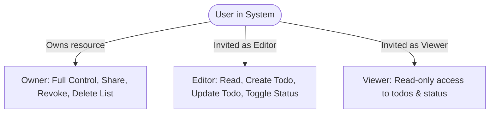
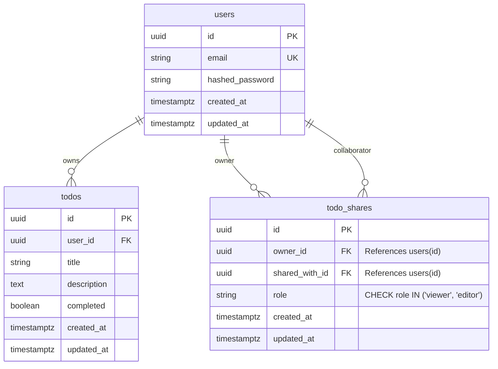
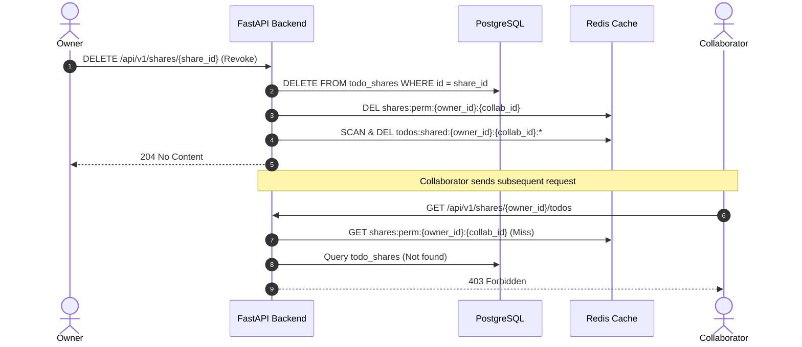

# Technical Specification: Collaborative Todo Sharing & Access Control (RBAC)

> **Document Version**: 1.0.0  
> **Status**: Ready for Architecture Review & RFC  
> **Author**: Senior Full-Stack Engineer  
> **Target Release**: Fabbi Todo Platform v1.1.0  
> **Guideline Reference**: [`templates/SPEC_TEMPLATE.md`](../templates/SPEC_TEMPLATE.md)

---

## 1. Overview & Objective

### 1.1 Feature Summary
Tính năng **Collaborative Todo Sharing** cho phép người dùng (Owner) chia sẻ danh sách công việc của mình cho người dùng khác trong hệ thống với các mức phân quyền chi tiết: **Viewer** (chỉ đọc) hoặc **Editor** (có quyền tạo, cập nhật, đổi trạng thái công việc). Chủ sở hữu có toàn quyền theo dõi danh sách thành viên được chia sẻ và thu hồi (revoke) quyền truy cập bất kỳ lúc nào.

### 1.2 Problem Statement
Hiện tại, mỗi người dùng trong Fabbi Todo hoạt động hoàn toàn độc lập (siloed). Người dùng không thể phối hợp công việc nhóm, bàn giao đầu việc, hoặc công khai tiến độ cho cấp trên/đồng nghiệp. Việc thiếu cơ chế chia sẻ làm giảm giá trị ứng dụng trong môi trường làm việc cộng tác.

### 1.3 Target Audience & Roles
Hệ thống áp dụng mô hình phân quyền dựa trên vai trò (Role-Based Access Control - RBAC) theo từng tài nguyên:



- **Owner**: Người tạo ra danh sách/công việc. Có toàn quyền (CRUD, mời người khác, phân quyền, thu hồi quyền, xoá toàn bộ danh sách).
- **Editor**: Người được cấp quyền chỉnh sửa. Có thể xem danh sách, tạo công việc con mới, sửa tiêu đề/mô tả, đổi trạng thái completed. Không có quyền mời người khác, không được chuyển quyền sở hữu, không được xoá danh sách.
- **Viewer**: Người chỉ có quyền xem. Không được thực hiện bất kỳ thay đổi nào (POST/PUT/DELETE đều bị chặn 403 Forbidden).

---

## 2. User Stories & Acceptance Criteria

### User Story 1: Chia sẻ Todo cho người dùng khác
- **As an** Owner của danh sách công việc.
- **I want to** nhập email của một người dùng khác và chọn vai trò (`viewer` hoặc `editor`).
- **So that** họ có thể cùng theo dõi hoặc phối hợp xử lý công việc với tôi.
- **Acceptance Criteria**:
  - [x] Hệ thống chỉ cho phép mời người dùng đã tồn tại trong hệ thống (dựa theo email).
  - [x] Không thể tự chia sẻ cho chính mình (Self-sharing prevention -> HTTP 400).
  - [x] Không thể tạo nhiều bản ghi chia sẻ trùng lặp cho cùng một người nhận (Idempotent / Duplicate invite prevention -> HTTP 409).
  - [x] Người nhận ngay lập tức thấy danh sách được chia sẻ trong tab "Shared with Me".

### User Story 2: Chỉnh sửa công việc với vai trò Editor
- **As an** Editor được chia sẻ danh sách công việc.
- **I want to** đánh dấu hoàn thành (toggle status), cập nhật mô tả và thêm mới công việc trong phạm vi được chia sẻ.
- **So that** tôi có thể cập nhật tiến độ công việc theo thời gian thực.
- **Acceptance Criteria**:
  - [x] Editor có thể gọi các API `POST /todos` (thuộc owner), `PUT /todos/{id}`.
  - [x] Mọi thay đổi của Editor đều được ghi nhận và vô hiệu hoá cache ngay lập tức cho cả Owner và các Collaborator khác.
  - [x] Editor không thể xoá tài khoản Owner hay sửa đổi quyền chia sẻ của người khác.

### User Story 3: Thu hồi quyền truy cập (Revoke Access)
- **As an** Owner.
- **I want to** thu hồi quyền truy cập của một Collaborator bất kỳ lúc nào hoặc thay đổi vai trò giữa Viewer và Editor.
- **So that** tôi kiểm soát hoàn toàn tính bảo mật của tài liệu khi nhân sự thay đổi.
- **Acceptance Criteria**:
  - [x] Khi Owner xoá share permission, phiên truy cập của Collaborator đối với tài nguyên đó lập tức bị vô hiệu hoá.
  - [x] Toàn bộ Redis cache của Collaborator liên quan đến dữ liệu được chia sẻ bị huỷ bỏ ngay lập tức.
  - [x] Nếu Collaborator đang thao tác dở và gửi request sau khi bị revoke, hệ thống trả về ngay HTTP 403 Forbidden.

---

## 3. Scope Boundaries

### 3.1 In-Scope (Phase 1 MVP)
- Chia sẻ toàn bộ Todo list của một người dùng theo User ID.
- Phân quyền 2 mức: `viewer` và `editor`.
- Quản lý danh sách chia sẻ: Xem danh sách collaborator, đổi quyền (Viewer <-> Editor), thu hồi quyền (Revoke).
- Xem danh sách Todo được chia sẻ ("Shared with Me").
- Cache invalidation đa người dùng qua Redis Pub/Sub hoặc scoped key clearing.

### 3.2 Out-of-Scope (Future Enhancements)
- Chia sẻ công khai qua liên kết nặc danh không cần login (Public Link Sharing).
- Mời qua email cho người chưa đăng ký tài khoản (User Invitation flow with sign-up tokens).
- Lịch sử chỉnh sửa chi tiết theo từng dòng (Audit Log / Revision History).
- Phân quyền cấp độ từng Todo đơn lẻ (Granular per-item ACL).

---

## 4. Database Architecture & Data Modeling

### 4.1 Entity Relationship Diagram (ERD)



### 4.2 DDL Schema (PostgreSQL)

```sql
-- Create Enum or Constraint for Share Roles
CREATE TYPE share_role AS ENUM ('viewer', 'editor');

CREATE TABLE todo_shares (
    id UUID PRIMARY KEY DEFAULT gen_random_uuid(),
    owner_id UUID NOT NULL,
    shared_with_id UUID NOT NULL,
    role VARCHAR(20) NOT NULL DEFAULT 'viewer',
    created_at TIMESTAMPTZ NOT NULL DEFAULT CURRENT_TIMESTAMP,
    updated_at TIMESTAMPTZ NOT NULL DEFAULT CURRENT_TIMESTAMP,

    -- Foreign Keys with Cascade Delete
    CONSTRAINT fk_shares_owner 
        FOREIGN KEY (owner_id) REFERENCES users(id) ON DELETE CASCADE,
    CONSTRAINT fk_shares_collaborator 
        FOREIGN KEY (shared_with_id) REFERENCES users(id) ON DELETE CASCADE,

    -- Business Rules & Constraints
    CONSTRAINT chk_no_self_sharing 
        CHECK (owner_id <> shared_with_id),
    CONSTRAINT chk_valid_role 
        CHECK (role IN ('viewer', 'editor')),
    CONSTRAINT uq_owner_collaborator 
        UNIQUE (owner_id, shared_with_id)
);

-- Indexing for high-performance lookup & permission checks
CREATE INDEX ix_todo_shares_shared_with ON todo_shares (shared_with_id, role);
CREATE INDEX ix_todo_shares_owner ON todo_shares (owner_id);
```

---

## 5. API Contracts & Endpoint Specifications

### 5.1 Endpoints Summary Table

| Method | Endpoint | Description | Auth Required | Permissions Required |
|---|---|---|---|---|
| **POST** | `/api/v1/shares` | Chia sẻ danh sách Todo cho người khác | Yes | Owner |
| **GET** | `/api/v1/shares/collaborators` | Lấy danh sách những người mình đang chia sẻ | Yes | Owner |
| **GET** | `/api/v1/shares/shared-with-me` | Lấy danh sách các Owner đang chia sẻ cho mình | Yes | Authenticated User |
| **PATCH** | `/api/v1/shares/{share_id}` | Cập nhật quyền (Viewer <-> Editor) | Yes | Owner |
| **DELETE** | `/api/v1/shares/{share_id}` | Thu hồi quyền truy cập (Revoke) | Yes | Owner |
| **GET** | `/api/v1/shares/{owner_id}/todos` | Xem danh sách Todo của Owner được chia sẻ | Yes | Collaborator (Viewer/Editor) |

---

### 5.2 Detailed Payload & Contract Specifications

#### `POST /api/v1/shares` — Chia sẻ quyền truy cập
- **Request Headers**: `Authorization: Bearer <access_token>`
- **Request Body**:
```json
{
  "email": "colleague@test.com",
  "role": "editor"
}
```
- **Response 201 Created**:
```json
{
  "id": "e4b2d19f-7c15-4673-8a30-811c75c893aa",
  "owner_id": "56283f5d-fdc1-48aa-ac87-f48170634139",
  "shared_with_id": "18f8e32a-5b12-4011-bb03-0c4a45a31b67",
  "shared_with_email": "colleague@test.com",
  "role": "editor",
  "created_at": "2026-10-03T07:30:00Z"
}
```
- **Error Responses**:
  - `400 Bad Request`: `{"detail": "Cannot share todos with yourself"}`
  - `404 Not Found`: `{"detail": "Target user with this email not found"}`
  - `409 Conflict`: `{"detail": "You have already shared your todos with this user"}`

---

#### `DELETE /api/v1/shares/{share_id}` — Thu hồi quyền
- **Response 204 No Content**
- **Error Responses**:
  - `403 Forbidden`: `{"detail": "You do not own this share record"}`
  - `404 Not Found`: `{"detail": "Share record not found"}`

---

## 6. Business Logic, Security Matrix & Edge Cases

### 6.1 Permission Matrix (RBAC)

| Resource Action | Owner | Editor | Viewer | Anonymous |
|---|:---:|:---:|:---:|:---:|
| Read Todos | ✅ | ✅ | ✅ | ❌ (401) |
| Create Todo | ✅ | ✅ | ❌ (403) | ❌ (401) |
| Update Todo (Title / Desc) | ✅ | ✅ | ❌ (403) | ❌ (401) |
| Toggle Completed Status | ✅ | ✅ | ❌ (403) | ❌ (401) |
| Delete Todo | ✅ | ❌ (403)* | ❌ (403) | ❌ (401) |
| Invite Collaborator | ✅ | ❌ (403) | ❌ (403) | ❌ (401) |
| Revoke Access | ✅ | ❌ (403) | ❌ (403) | ❌ (401) |

*\*Note: Để bảo vệ toàn vẹn dữ liệu, quyền Xoá Todo chỉ dành riêng cho Owner. Editor có thể đánh dấu hoàn thành hoặc gỡ bỏ nội dung nhưng không thể xoá vĩnh viễn record khỏi database.*

### 6.2 Critical Edge Cases & Mitigations

1. **Self-Sharing Prevention**:
   - *Nguy cơ*: User chia sẻ cho chính email của mình gây lặp vòng lặp logic và dơ database.
   - *Giải pháp*: Ràng buộc DB `CHECK (owner_id <> shared_with_id)` kết hợp validation tầng Service.
2. **Duplicate Invites & Idempotency**:
   - *Nguy cơ*: Nhấn đúp nút Share tạo nhiều bản ghi chia sẻ trùng lặp.
   - *Giải pháp*: Unique constraint `UNIQUE(owner_id, shared_with_id)` trả về HTTP 409 Conflict.
3. **Concurrent Mutation vs Revocation (Race Condition)**:
   - *Nguy cơ*: Owner thu hồi quyền đúng lúc Editor đang gửi PUT request cập nhật todo.
   - *Giải pháp*: Mỗi request ghi dữ liệu (write operation) phải kiểm tra quyền trong cùng một database transaction với `SELECT FOR SHARE` hoặc transaction isolation level Read Committed, đảm bảo tính nhất quán tức thì.

---

## 7. Caching & Invalidation Architecture (Redis)

### 7.1 Cache Key Taxonomy
Để hỗ trợ chia sẻ mà không làm rò rỉ dữ liệu:
- Owner's own list: `todos:list:{owner_id}:{page}:{size}`
- Collaborator's shared view: `todos:shared:{owner_id}:{collaborator_id}:{page}:{size}`
- Permission check cache: `shares:perm:{owner_id}:{collaborator_id}` (TTL: 300s)

### 7.2 Invalidation Workflow



- Khi Owner hoặc Editor cập nhật bất kỳ Todo nào trong danh sách chung, toàn bộ cache `todos:list:{owner_id}:*` và tất cả các `todos:shared:{owner_id}:*` của các collaborator liên quan đều được vô hiệu hoá tức thời thông qua `delete_pattern`.
